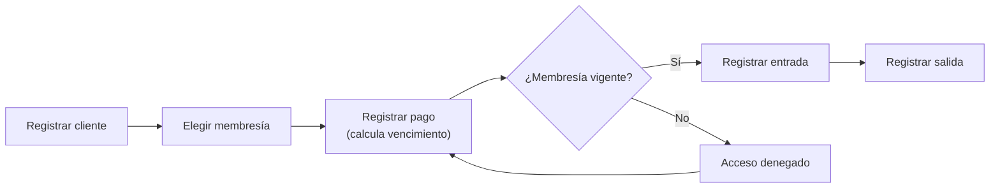
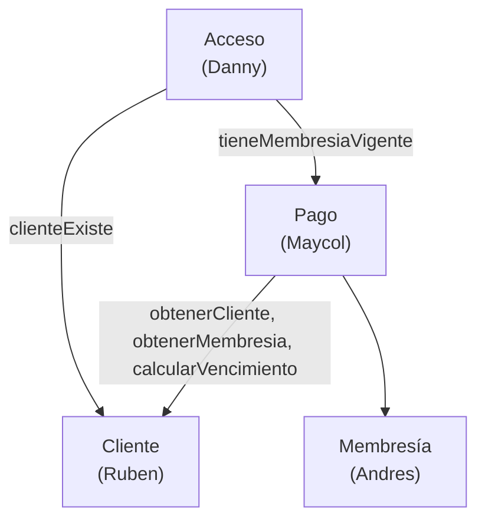

# Documento de Asignación de Responsabilidades y Funcionamiento del Sistema

**Proyecto:** Sistema de Gestión de Gimnasio / Control de Membresías
**Asignatura:** Pruebas de Software, ESPE (Carrera de Software)
**Equipo:** Maycol, Ruben, Andres y Danny
**Tecnología:** JavaScript (Node.js), Jest, ESLint, SonarQube
**Documentos relacionados:** `docs/modelado/*.mmd`, `database/schema.sql`, `docs/planificacion/reparto-trabajo.mmd`

---

## 1. Objetivo del documento

Este documento define, de forma única y vinculante para el equipo:

1. Cómo funciona el sistema (reglas de negocio y flujos).
2. Qué tabla, módulo, archivos y pruebas son responsabilidad de cada integrante.
3. Qué acuerdos (contratos) existen entre módulos para que los cuatro trabajemos **en paralelo sin chocar**.
4. Cómo se aplican los conceptos de la materia: verificación y validación, cobertura mínima del 70 % con Jest, análisis estático con ESLint y SonarQube, y defectos intencionales.

---

## 2. Funcionamiento del sistema

El gimnasio vende **membresías** a sus **clientes**. Cada compra se registra como un **pago**, que determina hasta qué fecha el cliente puede usar el gimnasio. Cada vez que el cliente entra o sale se registra un **acceso**.

### 2.1 Flujo general



### 2.2 Reglas de negocio

| Módulo | Regla |
|---|---|
| Cliente | `cedula` de 10 dígitos válida (algoritmo módulo 10 de la cédula ecuatoriana). |
| Cliente | `email` con formato válido; `telefono` de 7 a 15 dígitos (opcional). |
| Cliente | `cedula` y `email` son únicos. |
| Membresía | Tipos base: semanal (7 días), mensual (30 días), anual (365 días). |
| Membresía | `precio > 0` y `duracion_dias > 0`; `nombre` único. |
| Pago | `fecha_vencimiento = fecha_pago + duracion_dias` de la membresía. |
| Pago | `monto` debe ser igual al `precio` de la membresía. |
| Pago | Estados permitidos: `PAGADO`, `PENDIENTE`, `ANULADO`. |
| Pago | Una membresía está **vigente** si existe un pago `PAGADO` cuyo `fecha_vencimiento >= fecha consultada`. Los pagos `PENDIENTE` y `ANULADO` no cuentan. |
| Pago | Si el cliente renueva antes de vencer, el nuevo vencimiento se cuenta desde el vencimiento actual, no desde la fecha de pago. |
| Acceso | Solo puede entrar un cliente con membresía vigente. |
| Acceso | No se permite una segunda entrada si la anterior no tiene salida. |
| Acceso | `fecha_hora_salida >= fecha_hora_entrada`; la permanencia se calcula en minutos. |

---

## 3. Arquitectura

### 3.1 Capas por módulo

Cada módulo tiene la misma estructura, así todos leen el código de los demás sin esfuerzo:

```
src/modules/<modulo>/
    <modulo>.validaciones.js   # funciones puras de validación (las más fáciles de probar)
    <modulo>.repositorio.js    # acceso a datos (en memoria; luego se puede cambiar por PostgreSQL)
    <modulo>.servicio.js       # reglas de negocio; recibe sus dependencias por parámetro
    index.js                   # exporta únicamente el contrato público del módulo
tests/<modulo>/
    <modulo>.validaciones.test.js
    <modulo>.servicio.test.js
```

### 3.2 Dependencias entre módulos



### 3.3 Cómo se evita esperar al compañero

- Las dependencias se **inyectan** (el servicio las recibe al crearse). En las pruebas se reemplazan por **dobles de prueba (stubs/mocks de Jest)**.
- Cada persona programa contra el **contrato** de la sección 5, no contra el código real del otro.
- Los repositorios son en memoria, por lo que nadie necesita instalar ni compartir una base de datos para trabajar.
- `database/schema.sql` queda como referencia del modelo físico.

---

## 4. Asignación por integrante

El sistema tiene **4 tablas** (`CLIENTE`, `MEMBRESIA`, `PAGO`, `ACCESO`) y **cada integrante es responsable de exactamente una**.

### 4.1 Resumen

| Integrante | Tabla(s) asignada(s) | Módulo | Rama de funcionalidad | Revisa el PR de |
|---|---|---|---|---|
| **Maycol** | `PAGO` (y coordinación de calidad) | `src/modules/pago` + configuración global | `feature/setup-calidad`, luego `feature/pagos` | Danny |
| **Ruben** | `CLIENTE` | `src/modules/cliente` | `feature/clientes` | Maycol |
| **Andres** | `MEMBRESIA` | `src/modules/membresia` | `feature/membresias` | Ruben |
| **Danny** | `ACCESO` | `src/modules/acceso` | `feature/accesos` | Andres |

Los nombres de rama indican la funcionalidad, no la persona. Se crean desde `main` cuando cada quien empieza su parte.

### 4.2 Maycol: Pagos y calidad del proyecto

**Tabla:** `PAGO` (`id_pago`, `id_cliente`, `id_membresia`, `fecha_pago`, `fecha_vencimiento`, `monto`, `estado`).

**Responsabilidades:**
- Registrar pagos, calcular el vencimiento y validar que el monto coincida con el precio.
- Cambiar el estado del pago (`PENDIENTE` a `PAGADO`, anulación).
- Exponer `tieneMembresiaVigente(idCliente, fecha)`, que usa Danny.
- Manejar renovaciones y rechazar pagos duplicados.
- **Dueño de los archivos globales** (ver 6.1): `package.json`, `.eslintrc`, `jest.config.js`, `sonar-project.properties`, `.github/workflows/`.

**Archivos exclusivos:** `src/modules/pago/**`, `tests/pago/**`, y los archivos globales.

**Pruebas esperadas:** fechas límite (vence hoy, vence ayer, vence mañana), tabla de decisión de vigencia (estado × fecha), renovación anticipada, pago anulado.

### 4.3 Ruben: Clientes

**Tabla:** `CLIENTE` (`id_cliente`, `nombre`, `cedula`, `telefono`, `email`).

**Responsabilidades:**
- Alta, consulta, modificación y baja de clientes.
- Validar cédula (módulo 10), email y teléfono.
- Garantizar unicidad de cédula y email.
- Exponer `obtenerPorId(id)` y `clienteExiste(id)`.

**Archivos exclusivos:** `src/modules/cliente/**`, `tests/cliente/**`.

**Pruebas esperadas:** partición de equivalencia de cédula y email, valores límite del teléfono (6, 7, 15 y 16 dígitos), duplicados, cliente inexistente.

### 4.4 Andres: Membresías

**Tabla:** `MEMBRESIA` (`id_membresia`, `nombre`, `precio`, `duracion_dias`).

**Responsabilidades:**
- Alta, consulta, modificación y baja de tipos de membresía.
- Validar `precio > 0`, `duracion_dias > 0` y nombre único.
- Exponer `obtenerPorId(id)` y `calcularVencimiento(fechaPago, duracionDias)`.
- Manejar correctamente fines de mes y años bisiestos en el cálculo de fechas.

**Archivos exclusivos:** `src/modules/membresia/**`, `tests/membresia/**`.

**Pruebas esperadas:** valores límite (precio 0, 0.01, negativo; duración 0, 1), fechas del 28/29 de febrero, cambio de año.

### 4.5 Danny: Accesos

**Tabla:** `ACCESO` (`id_acceso`, `id_cliente`, `fecha_hora_entrada`, `fecha_hora_salida`).

**Responsabilidades:**
- Registrar entrada (solo con membresía vigente) y salida.
- Impedir doble entrada sin salida y salidas sin entrada.
- Calcular el tiempo de permanencia en minutos.
- Consultar quién está dentro del gimnasio.

**Archivos exclusivos:** `src/modules/acceso/**`, `tests/acceso/**`.

**Pruebas esperadas:** transiciones de estado (sin entrada, dentro, fuera), cliente inexistente, membresía vencida, salida anterior a la entrada, cruce de medianoche.

---

## 5. Contratos entre módulos

Estas firmas son el acuerdo. **No se cambian sin avisar al grupo y sin un PR que actualice este documento.** Mientras el módulo real no esté listo, cada quien usa un stub con la misma firma.

| Módulo (responsable) | Función pública | Devuelve |
|---|---|---|
| Cliente (Ruben) | `obtenerPorId(idCliente)` | `{ id_cliente, nombre, cedula, telefono, email }` o `null` |
| Cliente (Ruben) | `clienteExiste(idCliente)` | `boolean` |
| Membresía (Andres) | `obtenerPorId(idMembresia)` | `{ id_membresia, nombre, precio, duracion_dias }` o `null` |
| Membresía (Andres) | `calcularVencimiento(fechaPago, duracionDias)` | `Date` |
| Pago (Maycol) | `tieneMembresiaVigente(idCliente, fecha)` | `boolean` |
| Acceso (Danny) | `registrarEntrada(idCliente, fechaHora)` / `registrarSalida(idCliente, fechaHora)` | registro de acceso, o lanza `Error` con mensaje descriptivo |

**Convenciones comunes:**
- Fechas como objetos `Date`; para comparar vigencia se usa solo la parte de fecha (sin hora).
- Errores de negocio con `throw new Error('mensaje claro')`.
- Nombres de campos idénticos a los del modelo lógico (`id_cliente`, `fecha_pago`, etc.).
- Identificadores numéricos autoincrementales generados por el repositorio.

---

## 6. Reglas para no chocar

### 6.1 Propiedad de archivos

| Zona | Dueño | Regla |
|---|---|---|
| `src/modules/<modulo>/**` y `tests/<modulo>/**` | Responsable del módulo | Nadie más edita estas carpetas. Si hay un error, se avisa o se abre un issue. |
| `package.json`, `package-lock.json`, `.eslintrc*`, `jest.config.js`, `sonar-project.properties`, `.github/**` | Maycol | Si alguien necesita una dependencia o regla nueva, la pide a Maycol. |
| `docs/modelado/**`, `database/schema.sql` | Todos, por acuerdo | Solo se modifican con un PR dedicado y aprobado por el equipo. |
| `README.md` | Maycol | Cada quien aporta su sección por PR a Maycol, para evitar conflictos de merge. |

Como cada persona edita carpetas distintas, los conflictos de merge no deberían aparecer.

### 6.2 Flujo de Git

1. `main` está protegido: nadie hace push directo, todo entra por Pull Request.
2. Antes de empezar: `git checkout main && git pull`, luego `git checkout -b feature/<funcionalidad>`.
3. Commits pequeños y descriptivos con prefijos: `feat:`, `test:`, `fix:`, `docs:`, `refactor:`, `chore:`.
4. Antes de abrir el PR: `git pull origin main` para traer los cambios, y ejecutar `npm run lint` y `npm test`.
5. El PR lo revisa el integrante indicado en 4.1, y solo se fusiona con el CI en verde y al menos una aprobación.
6. Después del merge, se elimina la rama de funcionalidad.

### 6.3 Orden recomendado de entrada a `main`

1. **Maycol**: `feature/setup-calidad` (lo primero, porque da a todos Jest y ESLint).
2. Ruben, Andres, Danny y Maycol (`feature/pagos`) en paralelo, en cualquier orden.
3. Integración (control de acceso por membresía), cuando los módulos anteriores estén en `main`.

Mientras el setup no esté fusionado, cada quien puede escribir su código y sus pruebas en su rama; se ejecutan en cuanto se traiga `main`.

---

## 7. Calidad: verificación, validación y análisis estático

| Práctica | Herramienta | Criterio de aceptación |
|---|---|---|
| Verificación (¿construimos bien el producto?) | Jest (unitarias e integración) | Todas las pruebas pasan; **cobertura de código ≥ 70 %** (líneas, funciones, ramas y sentencias) en `jest.config.js`. |
| Validación (¿construimos el producto correcto?) | Casos de prueba derivados de las reglas de la sección 2.2 | Cada regla de negocio tiene al menos una prueba trazable (matriz requisito → prueba). |
| Análisis estático de estilo | ESLint | `npm run lint` sin errores. |
| Análisis estático de calidad | SonarQube (Docker, como en el Laboratorio 1) | Sin bugs ni vulnerabilidades abiertos; code smells revisados; calificación A. |
| Técnicas de diseño de casos | Partición de equivalencia, valores límite, tabla de decisión, transición de estados | Cada responsable documenta cuál usó en cada prueba. |

### 7.1 Defectos intencionales

Como parte del ejercicio, cada integrante introduce **dos defectos intencionales** en su módulo, siguiendo este ciclo:

1. Se documenta el defecto (qué es, dónde está y qué comportamiento incorrecto produce).
2. Se escribe la prueba que lo detecta (debe fallar).
3. Se corrige y la prueba pasa.

Cada defecto debe quedar en commits separados (`test:` que falla y luego `fix:`), para que el historial de Git sirva como evidencia. Ejemplos sugeridos:

| Responsable | Defecto sugerido |
|---|---|
| Maycol | Comparar `<` en lugar de `<=` al evaluar si el vencimiento es hoy; contar pagos `ANULADO` como vigentes. |
| Ruben | Aceptar cédulas de 9 o 11 dígitos; no detectar emails duplicados con distinta capitalización. |
| Andres | Sumar mal los días en febrero bisiesto; aceptar `precio = 0`. |
| Danny | Permitir doble entrada sin salida; calcular la permanencia en horas en lugar de minutos. |

---

## 8. Definición de terminado (por módulo)

- [ ] Validaciones, repositorio y servicio implementados según el contrato.
- [ ] Pruebas unitarias con cobertura propia ≥ 70 %.
- [ ] Dos defectos intencionales documentados, detectados y corregidos.
- [ ] `npm run lint` sin errores.
- [ ] Análisis de SonarQube del módulo sin bugs ni vulnerabilidades.
- [ ] PR aprobado por el revisor asignado y fusionado en `main`.

---

## 9. Cronograma de referencia

| Fase | Contenido | Responsables |
|---|---|---|
| 0 | Base del proyecto: Jest, ESLint, SonarQube, CI | Maycol |
| 1 | Módulos independientes en paralelo (clientes, membresías, accesos, pagos) | Ruben, Andres, Danny, Maycol |
| 2 | Integración: acceso solo con membresía vigente; reportes de morosos y clientes por vencer | Danny + Andres, Ruben + Maycol |
| 3 | Calidad y cierre: cobertura global, SonarQube, matriz de trazabilidad, informe | Todos |
